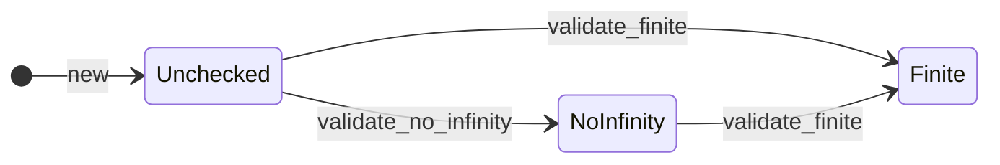

# Data

Every estimator takes its input as a `Dataset`: a feature matrix, one row per
sample and one column per feature, wrapped with a record of what is known about
its values.

## Why a dataset carries a state

Most algorithms break on NaN or infinity. A NaN in a matrix product spreads into
every coefficient of a linear model, and a NaN distance makes k-means assign rows
at random, all without any error. scikit-learn guards against this by scanning
the input again in every call to an estimator's `fit` or `predict` method.

This crate scans once and records the result in the type. A dataset starts as
`Unchecked`, and a `validate_*` method scans it and moves it to a stronger
state:

| State | Guarantees | Reached by |
|---|---|---|
| `Unchecked` | nothing | `Dataset::new` |
| `NoInfinity` | no ±infinity; NaN, meaning a missing value, is allowed | `validate_no_infinity` |
| `Finite` | no NaN and no ±infinity | `validate_finite` |

The upgrade paths, each one a single scan that either moves the dataset up or
returns a `NonFinite` error. There is no path back down:



A model that needs finite input accepts only `Dataset<Finite>`, so passing it
unchecked data is a compile error rather than a wrong model, and nothing after
the check needs to scan again.

```rust
{{#rustdoc_include ../../examples/data.rs:validate}}
```

`NoInfinity` exists for algorithms that handle missing values but not infinity,
which has no sensible meaning for them:

```rust
{{#rustdoc_include ../../examples/data.rs:missing}}
```

States only move up: a `Finite` dataset has no `validate_finite`, so checking
twice doesn't compile. Inside the crate, only these checks and transformers that
check what they write can produce a stronger state; the `State` trait is sealed,
so no other code can claim one.

## Targets

Supervised estimators also need targets `y`: what to predict for each row.
`with_y` attaches them, without copying, and checks them on the way in:

```rust
{{#rustdoc_include ../../examples/data.rs:targets}}
```

The element type says what kind of problem it is:

| Targets | Element type | Checked |
|---|---|---|
| Regression | `f32` or `f64` | every value finite |
| Classification | `usize`, a class index from `0` to `n_classes - 1` | nothing more: a `usize` can't be NaN |

Classes are indices, not names: encode class names as indices before attaching
them.

`y` is 1-D for one target per row, or 2-D (rows × outputs) for several. Several
outputs cover multi-output regression (predicting temperature *and* humidity),
multi-label classification (each row tagged yes / no for several labels), and
several class outputs per row. Either way `y` needs one row per sample, and a
2-D `y` at least one output; `with_y` returns `ShapeMismatch` or `EmptyInput`
otherwise.

Targets are checked once, when they are attached, so the dataset's state
describes only the features: features with missing values (`NoInfinity`) can
carry targets, and those targets are still finite. The `validate_*` methods
keep the targets as they are.

## Borrowed or owned

`Dataset::new` never copies. How you pass the array decides who owns it:

| Call | The dataset | Your array afterwards |
|---|---|---|
| `Dataset::new(&x)` or `Dataset::new(x.view())` | borrows it | still yours, unchanged |
| `Dataset::new(x)` | owns it | moved in: using `x` again is a compile error |

Validation moves the same array, borrowed or owned, into the new state.
Transformers return owned datasets. Both are the same type: `Dataset<'a, ..>`
borrows for the lifetime `'a`, and an owned dataset borrows nothing, so it can be
`Dataset<'static, ..>` and be returned from the function that made it.

`with_y` works the same way: `&y` or `y.view()` borrows the targets and `y`
moves them in. Features and targets share one lifetime, the shorter of their
borrows: owned features with borrowed targets live as long as the targets'
borrow, and owned features with owned targets can be `'static`.

## Float type

A dataset holds `f64` by default, or `f32`: the type is inferred from the array.
`f32` halves memory and can be faster; whether an estimator computes in `f32` or
widens to `f64` is documented on each estimator.
