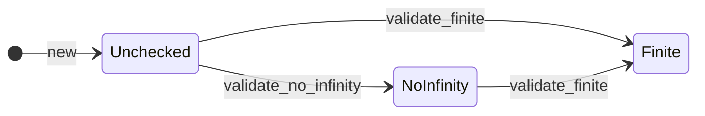

# Data

Every estimator takes its input as a `Dataset`: a feature matrix, one row per
sample and one column per feature, wrapped with a record of what is known about
its values.

## Why a dataset carries a state

Most algorithms break on NaN or infinity. A NaN in a matrix product spreads into
every coefficient of a linear model, and a NaN distance makes k-means assign rows
at random, all without any error. scikit-learn guards against this by scanning
the input again in every call to an estimator's `fit` or `predict` method.

This crate scans once and records the result in the type. A dataset starts as
`Unchecked`, and a `validate_*` method scans it and moves it to a stronger
state:

| State | Guarantees | Reached by |
|---|---|---|
| `Unchecked` | nothing | `Dataset::new` |
| `NoInfinity` | no ±infinity; NaN, meaning a missing value, is allowed | `validate_no_infinity` |
| `Finite` | no NaN and no ±infinity | `validate_finite` |

The upgrade paths, each one a single scan that either moves the dataset up or
returns a `NonFinite` error. There is no path back down:



A model that needs finite input accepts only `Dataset<Finite>`, so passing it
unchecked data is a compile error rather than a wrong model, and nothing after
the check needs to scan again.

```rust
{{#rustdoc_include ../../examples/data.rs:validate}}
```

`NoInfinity` exists for algorithms that handle missing values but not infinity,
which has no sensible meaning for them:

```rust
{{#rustdoc_include ../../examples/data.rs:missing}}
```

States only move up: a `Finite` dataset has no `validate_finite`, so checking
twice doesn't compile. Inside the crate, only these checks and transformers that
check what they write can produce a stronger state; the `State` trait is sealed,
so no other code can claim one.

## Targets

Supervised estimators also need targets `y`: what to predict for each row.
`with_y` attaches them, without copying, and checks them on the way in:

```rust
{{#rustdoc_include ../../examples/data.rs:targets}}
```

The element type says what kind of problem it is:

| Targets | Element type | Checked |
|---|---|---|
| Regression | `f32` or `f64` | every value finite |
| Classification | `usize`, a class index from `0` to `n_classes - 1` | nothing more: a `usize` can't be NaN |

Classes are indices, not names: encode class names as indices before attaching
them.

`y` is 1-D for one target per row, or 2-D (rows × outputs) for several. Several
outputs cover multi-output regression (predicting temperature *and* humidity),
multi-label classification (each row tagged yes / no for several labels), and
several class outputs per row. Either way `y` needs one row per sample, and a
2-D `y` at least one output; `with_y` returns `ShapeMismatch` or `EmptyInput`
otherwise.

Targets are checked once, when they are attached, so the dataset's state
describes only the features: features with missing values (`NoInfinity`) can
carry targets, and those targets are still finite. The `validate_*` methods
keep the targets as they are.

## Sample weights

Weights say how much each row counts. Weighted maths replaces every count with a
sum of weights. The mean becomes

$$\bar y = \frac{\sum_i w_i \, y_i}{\sum_i w_i} \quad \text{instead of} \quad \frac{1}{n} \sum_i y_i,$$

and least squares minimises $\sum_i w_i \, (y_i - \hat y_i)^2$. Weights are how
you trust some rows more than others, or store repeated rows once with their
count.

Wherever a model's objective is a sum over rows like these, a row with weight 2
has the same effect as the row appearing twice, and weight 0 the same as leaving
it out. That holds for most estimators, but not for every setting: a minimum
number of rows per tree leaf counts rows, not weight, and random sampling (as in
a random forest) draws a duplicated row twice as often as a weighted one. Each
estimator's page says where weights and repeated rows differ.

Every row weighs 1 until `with_sample_weights` sets a weight per row:

```rust
{{#rustdoc_include ../../examples/data.rs:weights}}
```

`sample_weights()` returns `None` while every row weighs 1, so estimators skip
the multiplications entirely instead of multiplying by a column of ones.

`with_sample_weights` checks one weight per sample, each finite and
non-negative. It doesn't require the weights to add up to more than zero: that
is checked in `fit`, like an empty dataset, because a subset of the rows (a
cross-validation fold) can weigh nothing even when the whole dataset doesn't.

Like targets, weights work in any feature state, before or after `with_y`, and
the `validate_*` methods keep them as they are. Calling `with_sample_weights`
again replaces them.

## Borrowed or owned

`Dataset::new` never copies. How you pass the array decides who owns it:

| Call | The dataset | Your array afterwards |
|---|---|---|
| `Dataset::new(&x)` or `Dataset::new(x.view())` | borrows it | still yours, unchanged |
| `Dataset::new(x)` | owns it | moved in: using `x` again is a compile error |

Validation moves the same array, borrowed or owned, into the new state.
Transformers return owned datasets. Both are the same type: `Dataset<'a, ..>`
borrows for the lifetime `'a`, and an owned dataset borrows nothing, so it can be
`Dataset<'static, ..>` and be returned from the function that made it.

`with_y` and `with_sample_weights` work the same way: `&y` or `y.view()`
borrows and `y` moves in. Features, targets and weights share one lifetime, the shorter of their
borrows: a long-lived dataset shortens to the targets' borrow, as a reference
would, and owned features with owned targets can be `'static`.

## Storage

Inside, a dataset stores its features as blocks of adjacent columns placed side
by side, each with one row per sample. The blocks themselves are private; what
the type records is how they are laid out, because that decides which
algorithms can read them without converting anything.

A layout has two parts. Its *orientation* says which way the values run in
memory: each row contiguous (row-major) or each column contiguous
(column-major). Reading along the contiguous direction is a run of adjacent
values; reading across it jumps through memory, which for a sparse matrix means
searching every row for one column. Its *density* says whether every entry is
stored (dense) or only some (sparse). The four single-kind layouts have their
own names:

| | Rows contiguous | Columns contiguous |
|---|---|---|
| **Dense** | `DenseRowMajor` | `DenseColMajor` |
| **Sparse** | `SparseRowMajor` (CSR) | `SparseColMajor` (CSC) |

All four are `Blocks<'a, F, O, D>` with orientation `O` (`Rows` or `Cols`) and
density `D` (`Dense` or `Sparse`). A dataset whose blocks differ along an axis
has the mixed marker there: `MixedOrientation` or `MixedDensity`. The number of
blocks is not part of the type: a `SparseRowMajor` dataset can hold several CSR
blocks side by side.

Each kind has a constructor that makes one block of it, borrowed or owned as
you pass it, never copied:

| Constructor | Takes | Makes |
|---|---|---|
| `Dataset::new` | an ndarray array | `DenseRowMajor` |
| `Dataset::from_row_major` | a `RowMajorMatrix` | `DenseRowMajor` |
| `Dataset::from_col_major` | a `ColMajorMatrix` | `DenseColMajor` |
| `Dataset::from_csr` | a `CsrMatrix` | `SparseRowMajor` |
| `Dataset::from_csc` | a `CscMatrix` | `SparseColMajor` |

An ndarray array doesn't say in its type which way it is stored, so a dense
array's memory order is checked once, when it is wrapped: `RowMajorMatrix::new`
and `ColMajorMatrix::new` return `Malformed` if the rows, or the columns,
aren't contiguous. `Dataset::new` is the everyday shortcut: it does the
row-major check and panics if it fails. Arrays built with `array!`, `zeros` or
`from_shape_vec` always pass, and so does a view of some of their columns; a
transposed view or a column-major array doesn't. Wrap column-major data with
`ColMajorMatrix`, or copy it into row-major order yourself with
`x.as_standard_layout()`:

```rust
{{#rustdoc_include ../../examples/data.rs:col_major}}
```

`DenseRowMajor` is the default layout, so you name it only when you write out
the state after it, as in `Dataset<'_, f64, DenseRowMajor<'_>, Finite>`, or
leave it to inference with `_`.

`blocks()` lends out the blocks themselves, in column order, and never copies:
a dense block as an `ArrayView2`, a sparse one as its `CsrMatrix` or
`CscMatrix`. Reading every value as one dense matrix is a conversion, below,
because for sparse data it can be far larger than what is stored.

### Stacking features side by side

`hstack` places one dataset's features after another's, as more columns of the
same rows, so dense and sparse features can sit in one dataset:

```rust
{{#rustdoc_include ../../examples/data.rs:hstack}}
```

Nothing is copied or converted: each block is moved into the result, borrowed
or owned as it was, and a sparse block stays sparse. The result's layout
follows from the two sides' layouts, one axis at a time: where both sides
agree, the result keeps it, and where they differ it is mixed. Above, both
sides run by rows, one dense and one sparse, so the result is `Blocks<Rows,
MixedDensity>`. Which layout you get never depends on sizes or on the
machine, only on the types going in. The columns keep their
order, left side first, so a bad value found by `validate_*` is reported at its
column in the stacked dataset.

Both sides need the same number of rows, or `hstack` returns `ShapeMismatch`.
They are also in the same state, which the result keeps, so two `Finite`
datasets stack into a `Finite` one without another scan; to stack fresh data
onto checked data, validate the fresh part first.

Targets and weights belong to rows, so only the left side keeps its own. A right
side with targets doesn't compile, and one with weights returns `Conflict`:
attach targets and weights after stacking. Sparse blocks on both sides also
need the same meaning for the entries they don't store (see [What an absent
entry means](#what-an-absent-entry-means)), or `hstack` returns `Conflict`, so
a dataset never holds two meanings at once.

### Converting between layouts

The layout changes only where you say so. Four methods take the dataset and
return its features as a single block of one kind:

| Method | Result |
|---|---|
| `into_dense_row_major()` | `DenseRowMajor` |
| `into_dense_col_major()` | `DenseColMajor` |
| `into_csr()`, `into_csr_with(absent)` | `SparseRowMajor` |
| `into_csc()`, `into_csc_with(absent)` | `SparseColMajor` |

```rust
{{#rustdoc_include ../../examples/data.rs:convert}}
```

A conversion usually copies: it allocates the result once and writes every
block into it. When the dataset already is one block of the target kind it
moves that block instead, so converting a dataset made by `new` to
`DenseRowMajor` still borrows your array. Either way the values don't change,
only how they are stored, so the state, targets and weights are kept.

To a sparse layout, a value is left out exactly when it is what an absent
entry stands for. `into_csr()` keeps the meaning the dataset's sparse blocks
have (0 if it has none); `into_csr_with(absent)` chooses one. Choosing
`Absent::Missing` for a matrix whose absent entries were 0 stores those zeros,
since leaving them out would turn them into missing values.

Building CSR is a counting sort over rows. One walk over the blocks counts the
entries each row will hold, a running sum turns the counts into
`row_offsets`, and a second walk writes each entry at its row's next free
position. Each block is walked in its own order, left to right, so the columns
within a row arrive in increasing order and need no sorting. CSC is the same
walk with columns as the lanes. It takes time proportional to the dense
blocks' size plus the sparse blocks' stored entries.

There is no read that turns the features into a dense matrix behind the
scenes: for a million documents of word counts over a hundred thousand words,
the dense `f64` matrix would take 800 GB, while about a hundred distinct words
per document store in under 2 GB.
To look at every value, convert, with `clone()` first if you want to keep the
original, and read the result's one block with `blocks()`.

### Selecting rows

`select_rows` takes a list of row numbers and returns those rows, with their
targets and weights, in the order given. It is how a train/test split or a
cross-validation fold becomes data. Rows may repeat, as a bootstrap sample
draws them.

```rust
{{#rustdoc_include ../../examples/data.rs:select}}
```

Every block keeps its kind, so the result has the same layout, state and
targets types as the dataset: a CSC block stays CSC, and selecting rows never
converts anything. What it costs depends on the rows asked for:

| Rows | Dense blocks, targets, weights | CSR block | CSC block |
|---|---|---|---|
| one ascending range, like `10..20` | borrowed | entries borrowed, row offsets rebuilt | copied |
| anything else | copied | copied | copied |

A range of rows is a slice of each dense array, so it is borrowed without
copying a value; a column-major slice still has contiguous columns. In CSR, a
range of rows is one run of the column indices and values, so those are
borrowed too, and only the row offsets are rebuilt, one per row, to start at
0. In CSC each column keeps a different run of its entries, and their row
numbers change, so selecting rows always copies.

Copying CSC rows maps each old row number to the new positions it was chosen
for, with a counting sort over the chosen rows, then walks every column once,
writing each stored entry once per new position. When the rows were ascending
without repeats the new row numbers come out in order; otherwise each column's
entries are sorted by their new row number, so the matrix stays canonical.

A row number out of range panics, as slice indexing does: it can only come
from a bug in the code that chose the rows.

## Sparse features

Many features are mostly zeros: word counts over a vocabulary, or a one-hot
encoding of a category with thousands of values. Storing every zero wastes
memory and time, so a `CsrMatrix` stores only the entries that are there, row
by row, in *compressed sparse row* (CSR) form:

```rust
{{#rustdoc_include ../../examples/data.rs:sparse}}
```

Three arrays describe it. Row $i$'s entries are positions
`row_offsets[i]..row_offsets[i + 1]` of `col_indices`, their columns, and of
`values`. Above, row 0 is positions 0 and 1: 5 in column 0 and 1 in column 3.
`n_cols` is given separately, because columns with nothing stored leave no
trace in the indices. Like dense arrays, each of the three is borrowed or moved
in, never copied.

`CsrMatrix::new` checks the structure: the offsets start at 0 and never
decrease, there is one column index and one value per stored entry, and within
a row the columns are less than `n_cols` and strictly increasing, so in order
and never repeated. It returns `Malformed` or `ShapeMismatch` otherwise. The
values are checked later, by the `validate_*` methods, as for dense features,
and reported at their row and column.

Reading a row is one slice, so CSR suits work done row by row, such as
predictions. Reading a column means looking through every row.

A `CscMatrix` stores the same matrix the other way round: column $j$'s entries
are positions `col_offsets[j]..col_offsets[j + 1]` of `row_indices`, their
rows, and of `values`, with `n_rows` given separately. Its structure is checked
the same way, with rows and columns swapped, and reading a column is one slice.
CSC suits work done column by column, such as coordinate descent, which updates
one feature's coefficient at a time:

```rust
{{#rustdoc_include ../../examples/data.rs:csc}}
```

### What an absent entry means

By default an entry that isn't stored is 0, as in scikit-learn: the sparse
matrix is the dense one with its zeros left out, and converting it to a
dense layout writes them back.

XGBoost reads sparse input differently: there, an absent entry is missing.
`with_absent(Absent::Missing)` gives a matrix that meaning. Converting it to
a dense layout then writes NaN, `validate_no_infinity` accepts absent entries like any missing
value, and `validate_finite` reports the first one, so such a matrix becomes
`Finite` only if it stores every entry.

`Dataset::with_absent` gives every sparse block in a dataset a meaning at
once, without copying: the stored entries stay and what the others stand for
changes. That changes values, so it exists only on `Unchecked` datasets; to
keep the values and change how they are stored, convert with
`into_csr_with` or `into_csc_with`.

## Float type

A dataset holds `f64` by default, or `f32`: the type is inferred from the array.
`f32` halves memory and can be faster; whether an estimator computes in `f32` or
widens to `f64` is documented on each estimator.
