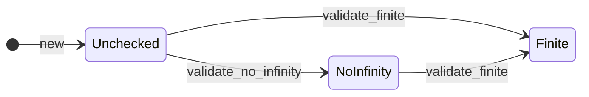

# Data

Every estimator takes its input as a `Dataset`: a feature matrix, one row per
sample and one column per feature, wrapped with a record of what is known about
its values.

## Why a dataset carries a state

Most algorithms break on NaN or infinity. A NaN in a matrix product spreads into
every coefficient of a linear model, and a NaN distance makes k-means assign rows
at random, all without any error. scikit-learn guards against this by scanning
the input again in every call to an estimator's `fit` or `predict` method.

This crate scans once and records the result in the type. A dataset starts as
`Unchecked`, and a `validate_*` method scans it and moves it to a stronger
state:

| State | Guarantees | Reached by |
|---|---|---|
| `Unchecked` | nothing | `Dataset::new` |
| `NoInfinity` | no ±infinity; NaN, meaning a missing value, is allowed | `validate_no_infinity` |
| `Finite` | no NaN and no ±infinity | `validate_finite` |

The upgrade paths, each one a single scan that either moves the dataset up or
returns a `NonFinite` error. There is no path back down:



A model that needs finite input accepts only `Dataset<Finite>`, so passing it
unchecked data is a compile error rather than a wrong model, and nothing after
the check needs to scan again.

```rust
{{#rustdoc_include ../../examples/data.rs:validate}}
```

`NoInfinity` exists for algorithms that handle missing values but not infinity,
which has no sensible meaning for them:

```rust
{{#rustdoc_include ../../examples/data.rs:missing}}
```

States only move up: a `Finite` dataset has no `validate_finite`, so checking
twice doesn't compile. Inside the crate, only these checks and transformers that
check what they write can produce a stronger state; the `State` trait is sealed,
so no other code can claim one.

## Targets

Supervised estimators also need targets `y`: what to predict for each row.
`with_y` attaches them, without copying, and checks them on the way in:

```rust
{{#rustdoc_include ../../examples/data.rs:targets}}
```

The element type says what kind of problem it is:

| Targets | Element type | Checked |
|---|---|---|
| Regression | `f32` or `f64` | every value finite |
| Classification | `usize`, a class index from `0` to `n_classes - 1` | nothing more: a `usize` can't be NaN |

Classes are indices, not names: encode class names as indices before attaching
them.

`y` is 1-D for one target per row, or 2-D (rows × outputs) for several. Several
outputs cover multi-output regression (predicting temperature *and* humidity),
multi-label classification (each row tagged yes / no for several labels), and
several class outputs per row. Either way `y` needs one row per sample, and a
2-D `y` at least one output; `with_y` returns `ShapeMismatch` or `EmptyInput`
otherwise.

Targets are checked once, when they are attached, so the dataset's state
describes only the features: features with missing values (`NoInfinity`) can
carry targets, and those targets are still finite. The `validate_*` methods
keep the targets as they are.

## Sample weights

Weights say how much each row counts. Weighted maths replaces every count with a
sum of weights. The mean becomes

$$\bar y = \frac{\sum_i w_i \, y_i}{\sum_i w_i} \quad \text{instead of} \quad \frac{1}{n} \sum_i y_i,$$

and least squares minimises $\sum_i w_i \, (y_i - \hat y_i)^2$. Weights are how
you trust some rows more than others, or store repeated rows once with their
count.

Wherever a model's objective is a sum over rows like these, a row with weight 2
has the same effect as the row appearing twice, and weight 0 the same as leaving
it out. That holds for most estimators, but not for every setting: a minimum
number of rows per tree leaf counts rows, not weight, and random sampling (as in
a random forest) draws a duplicated row twice as often as a weighted one. Each
estimator's page says where weights and repeated rows differ.

Every row weighs 1 until `with_sample_weights` sets a weight per row:

```rust
{{#rustdoc_include ../../examples/data.rs:weights}}
```

`sample_weights()` returns `None` while every row weighs 1, so estimators skip
the multiplications entirely instead of multiplying by a column of ones.

`with_sample_weights` checks one weight per sample, each finite and
non-negative. It doesn't require the weights to add up to more than zero: that
is checked in `fit`, like an empty dataset, because a subset of the rows (a
cross-validation fold) can weigh nothing even when the whole dataset doesn't.

Like targets, weights work in any feature state, before or after `with_y`, and
the `validate_*` methods keep them as they are. Calling `with_sample_weights`
again replaces them.

## Borrowed or owned

`Dataset::new` never copies. How you pass the array decides who owns it:

| Call | The dataset | Your array afterwards |
|---|---|---|
| `Dataset::new(&x)` or `Dataset::new(x.view())` | borrows it | still yours, unchanged |
| `Dataset::new(x)` | owns it | moved in: using `x` again is a compile error |

Validation moves the same array, borrowed or owned, into the new state.
Transformers return owned datasets. Both are the same type: `Dataset<'a, ..>`
borrows for the lifetime `'a`, and an owned dataset borrows nothing, so it can be
`Dataset<'static, ..>` and be returned from the function that made it.

`with_y` and `with_sample_weights` work the same way: `&y` or `y.view()`
borrows and `y` moves in. Features, targets and weights share one lifetime, the shorter of their
borrows: a long-lived dataset shortens to the targets' borrow, as a reference
would, and owned features with owned targets can be `'static`.

## Storage

Inside, a dataset stores its features as blocks of adjacent columns placed side
by side, each with one row per sample, and each dense or sparse.
`Dataset::new` makes a single dense block: your array, borrowed or owned.
`Dataset::from_csr` makes a single sparse one. The storage is private, so it
can gain other kinds of block without changing how a dataset is used.

`to_dense()` returns the features as one matrix. For a single dense block, as
`new` makes, it borrows that block, without copying; a sparse block is written
out into a new matrix.

## Sparse features

Many features are mostly zeros: word counts over a vocabulary, or a one-hot
encoding of a category with thousands of values. Storing every zero wastes
memory and time, so a `CsrMatrix` stores only the entries that are there, row
by row, in *compressed sparse row* (CSR) form:

```rust
{{#rustdoc_include ../../examples/data.rs:sparse}}
```

Three arrays describe it. Row $i$'s entries are positions
`row_offsets[i]..row_offsets[i + 1]` of `col_indices`, their columns, and of
`values`. Above, row 0 is positions 0 and 1: 5 in column 0 and 1 in column 3.
`n_cols` is given separately, because columns with nothing stored leave no
trace in the indices. Like dense arrays, each of the three is borrowed or moved
in, never copied.

`CsrMatrix::new` checks the structure: the offsets start at 0 and never
decrease, there is one column index and one value per stored entry, and within
a row the columns are less than `n_cols` and strictly increasing, so in order
and never repeated. It returns `Malformed` or `ShapeMismatch` otherwise. The
values are checked later, by the `validate_*` methods, as for dense features,
and reported at their row and column.

Reading a row is one slice, so CSR suits work done row by row, such as
predictions. Reading a column means looking through every row.

### What an absent entry means

By default an entry that isn't stored is 0, as in scikit-learn: the sparse
matrix is the dense one with its zeros left out, and `to_dense()` writes them
back.

XGBoost reads sparse input differently: there, an absent entry is missing.
`with_absent(Absent::Missing)` gives a matrix that meaning. `to_dense()` then
writes NaN, `validate_no_infinity` accepts absent entries like any missing
value, and `validate_finite` reports the first one, so such a matrix becomes
`Finite` only if it stores every entry.

## Float type

A dataset holds `f64` by default, or `f32`: the type is inferred from the array.
`f32` halves memory and can be faster; whether an estimator computes in `f32` or
widens to `f64` is documented on each estimator.
