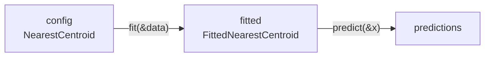

# Estimators

Every model in this crate is written against a handful of traits: one to check
its settings, one to learn from data, and one each to predict and transform.
This page explains how they fit together, using a small classifier as the
running example.

## Config and fitted model

An estimator is two types. The *config* holds the settings a user chooses, and
fitting it returns a *fitted* type holding what was learned:



scikit-learn uses one object for both: `fit` stores what it learned on the same
object, and calling `predict` before `fit` is a runtime error. Here a config has
no `predict` method at all, so that mistake doesn't compile, and fitting the
same config twice with different data gives two independent models.

The example is *nearest centroid*: for each class it learns the centroid, the
(weighted) mean of that class's rows,

$$
\mu_k = \frac{\sum_{i : y_i = k} w_i x_i}{\sum_{i : y_i = k} w_i},
$$

and predicts the class whose centroid is closest in squared Euclidean distance,
$\hat{y} = \arg\min_k \lVert x - \mu_k \rVert^2$. It is scikit-learn's
`NearestCentroid` without its shrinkage setting, and it fails when classes
aren't well described by their mean: two rings around the same centre have the
same centroid.

```rust,ignore
{{#rustdoc_include ../../examples/estimator.rs:config}}
```

## The traits

| Trait | Implemented by | Method | Takes the data |
|---|---|---|---|
| `ValidateConfig` | config | `validate_config(&self)` | no data |
| `Fit<In>` | config | `fit(&self, &In) -> Fitted` | borrowed |
| `Predict<In>` | fitted | `predict(&self, &In) -> Output` | borrowed |
| `PredictProbability<In>` | fitted classifier | `predict_probability(&self, &In)` | borrowed |
| `Transform<In>` | fitted transformer | `transform(&self, In) -> Output` | owned |
| `FitTransform<In>` | config | `fit_transform(&self, In)` | owned |

Every method returns `Result`, so a bad setting or a shape mismatch is an error
the caller can handle, never a panic.

**`ValidateConfig`** checks the settings, and every `fit` calls it before
reading any data. It is its own trait, not part of `Fit`, because an estimator
implements `Fit` once per input it accepts but its settings are checked the same
way for all of them. Its default accepts everything.

**`Fit` borrows.** Fitting only reads the data, so borrowing lets the same
dataset be fitted again with other settings, or used for cross-validation,
without a copy.

**`Predict` borrows and ignores targets.** A model's `Predict` impl is generic
over the targets, so it accepts a dataset with or without them, and since it
doesn't know their type it can't read them.

**`Transform` takes ownership.** A transformer such as a scaler rewrites
values. With ownership it can rewrite values the dataset owns in place, and copy
borrowed ones only once. To transform a dataset and keep it, transform a view
(below).

**`FitTransform`** fits and transforms in one call. Its default fits on a borrow
and then transforms, exactly as calling the two in turn. Each transformer opts
in with an empty impl, and one that can do both in a single pass over the data
overrides the method.

## How the input type picks the implementation

The traits are generic over their input. An estimator implements `Fit` for
exactly the datasets it can use, named by the dataset's type parameters: the
layout `L`, the state `S` and the targets `Y`. Nearest centroid needs finite,
dense, row-major features and classes as targets:

```rust,ignore
{{#rustdoc_include ../../examples/estimator.rs:fit}}
```

Each of those is checked by the compiler:

- **State.** Means are wrecked by a single NaN, so `S` is `Finite`: the user
  must call `validate_finite` first.
- **Targets.** `Targets<'a, usize>` asks for class indices. Float targets, or
  none, don't fit.
- **Layout.** The impl reads whole rows, which `DenseRowMajor` stores
  contiguously. A sparse or column-major dataset must be converted explicitly,
  so its cost is visible in the user's code.

An estimator that works well on several layouts implements `Fit` once for each,
each written for that layout's access pattern; that's the point of making the
layout part of the type. Prediction has the same shape, generic over `Y`:

```rust,ignore
{{#rustdoc_include ../../examples/estimator.rs:predict}}
```

The number of features is a runtime value, so `predict` checks it and returns
`ShapeMismatch`. Using it:

```rust,ignore
{{#rustdoc_include ../../examples/estimator.rs:use}}
```

Passing anything else is a compile error. With two or more `Fit` impls, the
compiler reports which datasets the estimator does fit and suggests the three
fixes: validate the state, attach targets, or convert the layout. With only one
impl it infers that one and reports a type mismatch against it instead, which
names the same three parts of the type.

## Views

`Dataset::view` borrows a dataset as a new dataset with the same layout, state
and targets, copying nothing: every block, the targets and the weights point at
the original's memory. It is how a dataset is transformed and kept, since
`transform` takes ownership: `scaler.transform(data.view())` leaves `data` to
be used again.

A view of an owned dataset borrows it; a view of a borrowed dataset borrows the
same caller's arrays.

## Who checks what

Each check runs where its input first appears, so nothing is checked twice
and an estimator only checks what depends on it.

| Checked | Where | How |
|---|---|---|
| dense memory order (each row or column contiguous) | `RowMajorMatrix::new`, `ColMajorMatrix::new`, `Dataset::new` | once, when built |
| sparse structure (offsets, sorted indices in range) | `CsrMatrix::new`, `CscMatrix::new` | once, when built |
| blocks side by side (same rows, no weights on the right, one `Absent`) | `hstack` | once, when joined |
| NaN and infinity | `validate_*` | once, recorded in `S` |
| targets: rows, then outputs, then values (floats finite) | `with_y` | once, recorded in `Y` |
| weights: length, then each value finite and non-negative | `with_sample_weights` | once |
| settings | `fit`, via `validate_config` | every fit |
| at least one row, total weight positive | `fit` | every fit |
| layout and state accepted | compiler | trait impls |
| number of features | `predict`, `transform` | every call |

The total weight is left to `fit` because it depends on the rows used: a
training fold can hold only zero-weight rows even when the whole dataset
doesn't.
