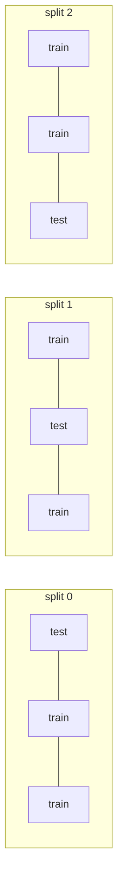

# Model selection

A model fitted on some rows has seen their answers, so scoring it on the same
rows measures how well it memorised them, not how well it does on new data. A
deep decision tree scores perfectly on its own training rows. To estimate how
a model *generalises*, hold rows out: fit on a **training** side, score on a
**test** side the model never saw.

`predict::selection` makes the splits, and cross-validation fits and scores an
estimator on each.

## Splits are row numbers

Every splitter implements the `Splitter` trait and makes `Split`s:

```rust,ignore
pub struct Split {
    pub n_samples: usize,
    pub train: Vec<usize>,
    pub test: Vec<usize>,
}
```

Splitting only deals in row numbers, so it doesn't depend on the layout, state
or targets of the data. `Split::select` turns a split into two datasets with
[`select_rows`](data.md#selecting-rows), keeping the layout, state, targets and
weights. A side that is one ascending range of rows is borrowed; any other is
copied once. Both sides are ascending in every split this crate makes, so rows
keep their original relative order, and copying them reads memory forwards.

`n_samples` records which data the split was made for: selecting with data of
another size panics, rather than silently picking the wrong rows. The fields
are public, so a split chosen by hand is a struct literal.

A splitter names what it reads besides the number of rows as its `By` type:
`()` for nothing, `Classes` for one class per row. Passing the wrong input is a
compile error, so a splitter can't be given an input it would ignore.

## A train/test split

`TrainTestSplit` holds out a fraction of the rows as one test set:

```rust,ignore
{{#rustdoc_include ../../examples/selection.rs:split}}
```

The test side has $\lceil \text{test\_size} \cdot n \rceil$ rows (a quarter by
default), rounded up as in scikit-learn so it is never empty. The rows are
chosen at random, because data files are often sorted by date, class or
source: the last quarter of a sorted file might hold only one class.

Sometimes the order is the point, as when a model should be tested on later
data than it was fitted on. `without_shuffle` keeps the rows in order, with the
last rows as the test side; each side is then one range, and both are borrowed.

## K-fold

One test set gives a noisy estimate: with 250 test rows, a different 250 could
move accuracy by a few points. K-fold cross-validation repeats the hold-out K
times so that every row is tested exactly once:



`KFold` cuts the rows into K consecutive folds (5 by default), the first
$n \bmod K$ of them one row larger. A larger K trains each model on more rows,
so its score is less pessimistic, at the cost of K fits. Rows are taken in
order unless shuffled with `with_shuffle(Seed)`, which is worth doing whenever
the rows are sorted.

### Keeping class proportions

With 5% of 1,000 rows in one class, a random fold of 200 should hold about 10
of them but might hold 3, and that fold's recall would rest on 3 rows: the
scores would vary with the split rather than the model. `StratifiedKFold`
reads one class per row and keeps each class's share in every fold.

It deals each class's rows to the folds in turn, each class carrying on from
the fold where the last one stopped, so fold sizes differ by at most one row:

| Rows | 0 | 1 | 2 | 3 | 4 | 5 | 6 | 7 |
|---|---|---|---|---|---|---|---|---|
| Class | 0 | 0 | 0 | 0 | 1 | 1 | 1 | 1 |
| Fold (K = 3) | 0 | 1 | 2 | 0 | 1 | 2 | 0 | 1 |

scikit-learn gives each class consecutive blocks with the same counts instead;
dealing spreads a class more evenly when the rows drift over time. A class with
fewer rows than folds is an error, since some test side would lack it.
scikit-learn only warns.

## Cross-validation

`CrossValidation` takes a splitter, and its `score` method fits an estimator
on each training side, predicts the test side, and scores the
predictions with a [metric](metrics.md). The example below cross-validates a
baseline that predicts the training mean for every row:

```rust,ignore
{{#rustdoc_include ../../examples/selection.rs:baseline}}
```

```rust,ignore
{{#rustdoc_include ../../examples/selection.rs:cross_validation}}
```

It prints one $R^2$ per fold, each just below 0. $R^2 = 0$ is the score of
predicting the test targets' own mean; the training mean is slightly off it,
so on held-out rows the baseline scores a little worse. Any real model must
beat it.

- **One score per split**, in split order. A plain mean weighs every split
  equally, and K-fold sizes differ by at most one row.
- **The splitter is always given**, so which rows train and which test is
  visible in the code. For classification, pass `StratifiedKFold` and
  `Classes(data.y())`.
- **Weights count on both sides.** With sample weights, the fit uses the
  training side's and the metric the test side's, so the score measures what
  the fit optimises. scikit-learn weights only the fit unless asked.
- **One split at a time.** Each split's rows are selected when it is fitted
  and dropped once it is scored, so memory peaks at about twice the data.
- **The first error wins.** A split that fails to fit or score is an error,
  never a NaN score.

`score` takes any type implementing `Metric`, including `&dyn Metric`.

### Fitting at any lifetime

Each split borrows the data for as long as it is fitted, a lifetime that only
exists inside `score`, so the estimator must fit a dataset of *any* lifetime.
`score` asks for that with a higher-ranked bound:

```rust,ignore
E: for<'b> Fit<Dataset<'b, F, Blocks<'b, F, O, D>, S, Targets<'b, T>>, Fitted = P>
```

Estimators written as `impl<'a> Fit<Dataset<'a, ..>>`, as every estimator in
this crate is, satisfy it.
